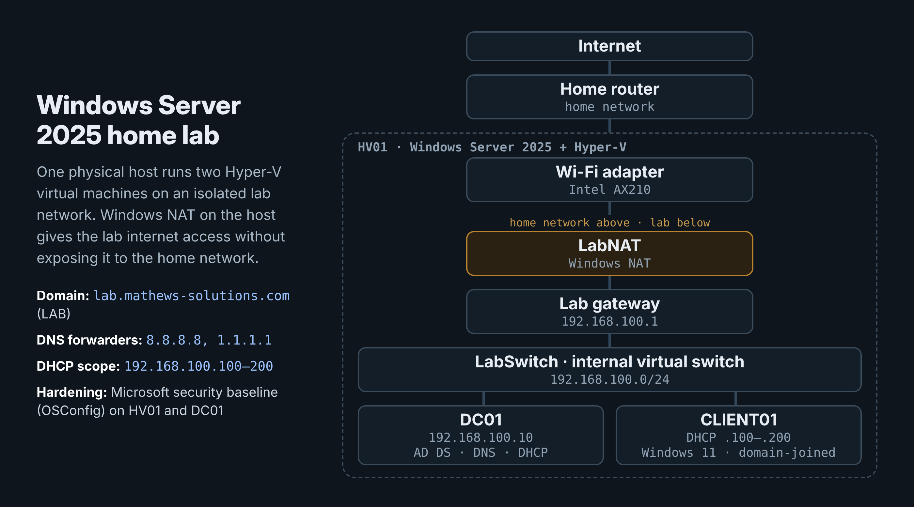
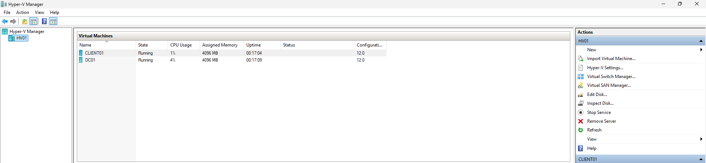
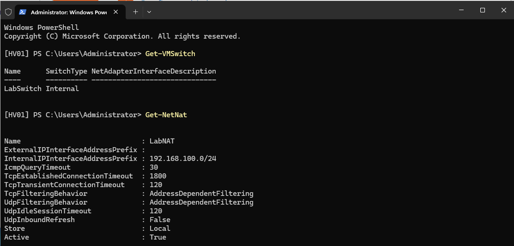
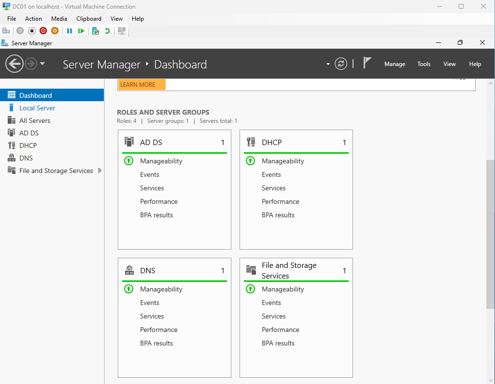
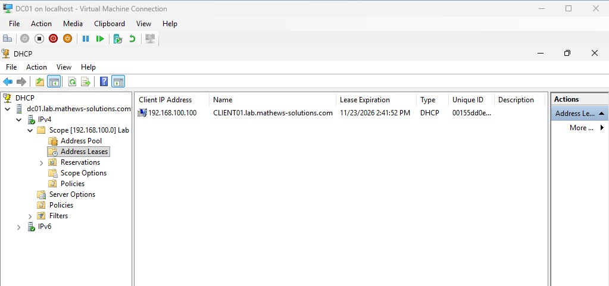
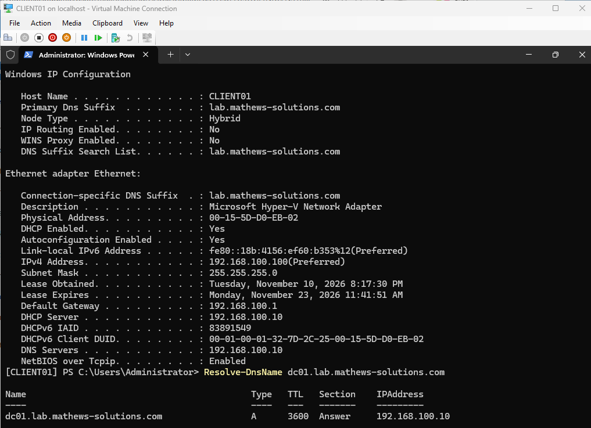
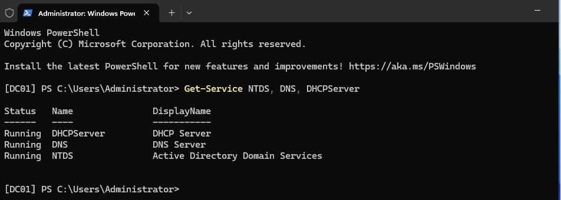

# Windows Server 2025 Home Lab

A self-built Windows domain running on a repurposed Dell OptiPlex: a Hyper-V host, a domain controller providing Active Directory, DNS and DHCP, and a domain-joined Windows 11 workstation, all on an isolated lab network and hardened with Microsoft's security baseline.

I built this to get hands-on experience with the systems a help desk and junior systems administrator support every day.



## At a glance

| Machine | Role | OS | Address |
|---|---|---|---|
| **HV01** | Physical Hyper-V host, lab gateway, NAT | Windows Server 2025 Datacenter | Home Wi-Fi + `192.168.100.1` |
| **DC01** | Domain controller: AD DS, DNS, DHCP | Windows Server 2025 Standard (VM) | `192.168.100.10` (static) |
| **CLIENT01** | Domain-joined workstation | Windows 11 Enterprise (VM) | DHCP, `192.168.100.100–200` |

- **Domain:** `lab.mathews-solutions.com` (NetBIOS: `LAB`)
- **Lab subnet:** `192.168.100.0/24` on an internal Hyper-V switch
- **Hardware:** Dell OptiPlex 7020, Intel i7-4790, 32 GB RAM, 500 GB SSD, Intel AX210 Wi-Fi card

## Skills demonstrated

- **Virtualization:** Hyper-V role, Generation 2 VMs, virtual TPM, internal virtual switches, checkpoints
- **Networking:** subnetting, static vs. DHCP addressing, default gateways, Windows NAT, DNS forwarding
- **Active Directory:** new forest and domain, domain join, OUs, users and groups, password resets, account unlocks, offboarding
- **Permissions:** group-based NTFS and SMB share permissions, mapped drives
- **DHCP:** server authorization in AD, scopes, scope options (router, DNS server, DNS domain)
- **Security:** Microsoft Windows Server 2025 security baseline via OSConfig, Secure Boot, memory integrity (HVCI), UAC and least privilege, firewall and Defender checks, password and lockout policy
- **PowerShell:** most of the build was done from the command line
- **Troubleshooting:** driver installation on unsupported hardware, VM boot problems, permission errors after hardening

## How it was built

### 1. Hardware and host install
- Enabled Intel VT-x and VT-d, set AHCI and UEFI boot in the BIOS.
- Created UEFI/GPT install media with Rufus and installed Windows Server 2025 Datacenter (Desktop Experience).

### 2. Host networking
The host connects over Wi-Fi. Windows Server 2025 doesn't include the Intel AX210 driver and leaves the wireless service on manual start, so I installed Intel's driver-only package through Device Manager and set `WlanSvc` to start automatically.

### 3. Isolated lab network
I used an **internal** switch with **NAT** instead of an external switch. That keeps the lab's DHCP server from conflicting with my home router, and avoids external switches over Wi-Fi.

```powershell
New-VMSwitch -SwitchName "LabSwitch" -SwitchType Internal
New-NetIPAddress -IPAddress 192.168.100.1 -PrefixLength 24 -InterfaceAlias "vEthernet (LabSwitch)"
New-NetNat -Name "LabNAT" -InternalIPInterfaceAddressPrefix 192.168.100.0/24
```

### 4. Domain controller (DC01)
```powershell
New-NetIPAddress -InterfaceAlias "Ethernet" -IPAddress 192.168.100.10 -PrefixLength 24 -DefaultGateway 192.168.100.1
Install-WindowsFeature AD-Domain-Services -IncludeManagementTools
Install-ADDSForest -DomainName "lab.mathews-solutions.com" -DomainNetbiosName "LAB" -InstallDns
Set-DnsServerForwarder -IPAddress 8.8.8.8, 1.1.1.1
```

DHCP was installed, authorized in Active Directory, and given a scope with gateway, DNS and domain options:

```powershell
Install-WindowsFeature DHCP -IncludeManagementTools
Add-DhcpServerInDC -DnsName dc01.lab.mathews-solutions.com -IPAddress 192.168.100.10
Add-DhcpServerv4Scope -Name "Lab" -StartRange 192.168.100.100 -EndRange 192.168.100.200 -SubnetMask 255.255.255.0
Set-DhcpServerv4OptionValue -ScopeId 192.168.100.0 -Router 192.168.100.1 -DnsServer 192.168.100.10 -DnsDomain lab.mathews-solutions.com
```

### 5. Workstation (CLIENT01)
A Windows 11 Enterprise VM with a virtual TPM. It received its address and DNS settings from DC01, then joined the domain:

```powershell
Add-Computer -DomainName lab.mathews-solutions.com -NewName CLIENT01 -Credential LAB\Administrator -Restart
```

## Help desk practice

I turned the domain into a small company and worked through common help desk tickets, using both **Active Directory Users and Computers** and PowerShell.

| Ticket | What I did |
|---|---|
| Company setup | Created a `LabCorp` OU structure (Users, Computers, Groups, Disabled Users) and Sales and HR security groups |
| New hire | Created user accounts with temporary passwords and "must change at next logon," and added them to department groups |
| Forgotten password | Verified identity first, then reset the password in ADUC with a forced change at next sign-in |
| Account locked out | Confirmed the domain lockout policy (5 attempts), reproduced a lockout, found it with `Search-ADAccount -LockedOut`, and unlocked it |
| Account lookup | Checked status, last sign-in, password age and group membership with `Get-ADUser` |
| Shared folder access | Created a Sales share with group-based NTFS (`icacls`) and share permissions, confirmed access was denied for a non-member, and granted it through group membership |
| Mapped drive | Mapped `S:` to the share with `net use` |
| Offboarding | Disabled the account, removed group memberships, and moved it to Disabled Users |

**Lessons that came up:**
- New group membership only applies after the user signs out and back in.
- Disabling an account doesn't end a session that's already open.
- `New-ADUser` creates the account before setting the password, so a rejected password leaves a disabled account behind. Fix it in place instead of recreating it.

## Security hardening

- Checked the baseline state: firewall profiles, Microsoft Defender, Secure Boot, Remote Desktop, installed features.
- Raised the local Administrator password to 14+ characters.
- Applied Microsoft's Windows Server 2025 security baseline with OSConfig: the `WorkgroupMember` baseline on HV01, and the `DomainController` baseline on DC01 after taking a checkpoint.
- Verified afterward that AD DS, DNS, DHCP, NAT and domain sign-in all still worked.
- Cleared a locked BIOS admin password with the motherboard PSWD jumper, then enabled **Secure Boot** on the host (`Confirm-SecureBootUEFI` returns `True`).
- Confirmed **memory integrity (HVCI)** is configured and running on HV01 via `Win32_DeviceGuard`. Credential Guard isn't configured there, which has little effect since the host isn't domain-joined.

**Effects I observed after hardening:** the sign-in screen no longer shows the last user, the built-in Administrator now gets UAC prompts, and Hyper-V and service commands fail with permission or "not found" errors unless PowerShell runs elevated.

## Troubleshooting log

| Problem | Cause | Fix |
|---|---|---|
| Wi-Fi adapter missing after restart | Wireless service set to manual; Intel driver not included in Windows Server | Installed Intel's driver-only package via Device Manager; set `WlanSvc` to Automatic |
| `New-NetNat`: "duplicate name exists on the network" | LabNAT already existed (command run twice) | Confirmed with `Get-NetNat`; only one NAT is allowed per host |
| VM: "No operating system was loaded" | The "Press any key to boot from DVD" prompt timed out | Turned the VM off and pressed a key immediately on start |
| `Set-VMFirmware`: cannot convert `System.Object[]` | VM had two DVD drives from a repeated command | Removed all DVD drives and added one back |
| `Checkpoint-VM` not recognized | Run inside a VM instead of on the host | Ran Hyper-V commands on HV01 |
| `Start-VM`: "You do not have the required permission" after baseline | Baseline enabled UAC for the built-in Administrator | Ran PowerShell as administrator |
| `Get-Service NTDS` "cannot find any service" after baseline | Non-elevated session | Re-ran elevated: all services running |
| BIOS rejected its own admin password, locking all settings | Password mistyped when it was set | Cleared it with the PSWD jumper on the motherboard, then enabled Secure Boot |
| Server Manager role tiles red: "Online – Restart pending" | Updates waiting for a restart | Restarted DC01; tiles turned green |
| `New-ADUser` failed on password complexity, then "account already exists" | The account is created before the password is set | Set the password, required a change at next logon, and enabled the existing account |
| `Move-ADObject`: "object's parent is either uninstantiated or deleted" | OU path variable not set in a new PowerShell session | Re-set `$base` and confirmed the OU with `Get-ADOrganizationalUnit` |
| Local Server tile red under Services | On-demand services (edgeupdate, sppsvc, RemoteRegistry and others) stopped by design | Listed them with `Get-CimInstance Win32_Service` and left them alone |

## Screenshots

| | |
|---|---|
|  |  |
| Hyper-V Manager with both VMs | LabSwitch and LabNAT on the host |
|  |  |
| AD DS, DNS and DHCP on DC01 | DHCP scope and CLIENT01's lease |
|  |  |
| CLIENT01 settings from DHCP | DC01 services after hardening |

## What I learned

- Why a domain controller needs a static address, and how DHCP, DNS and Active Directory depend on each other.
- How NAT lets an isolated network reach the internet without being reachable from outside.
- Running commands in the right place: Hyper-V commands on the host, service configuration inside each VM.
- Security baselines change everyday behavior, so verify everything still works after applying one.

## Next steps

- [x] Help desk practice: OUs, users, groups, password resets, account unlocks, share permissions, offboarding
- [ ] Remote Desktop access to CLIENT01 for a standard domain user
- [x] Enable Secure Boot on the host
- [ ] Add a firewall VM between lab subnets

## References

- [What's new in Windows Server 2025 (Microsoft Learn)](https://learn.microsoft.com/windows-server/get-started/whats-new-windows-server-2025)
- [Deploy Windows Server 2025 security baselines with OSConfig (Microsoft Learn)](https://learn.microsoft.com/windows-server/security/osconfig/osconfig-how-to-configure-security-baselines)
- [Intel PROSet/Wireless drivers for IT admins](https://www.intel.com/content/www/us/en/download/18231/intel-proset-wireless-software-and-drivers-for-it-admins.html)
